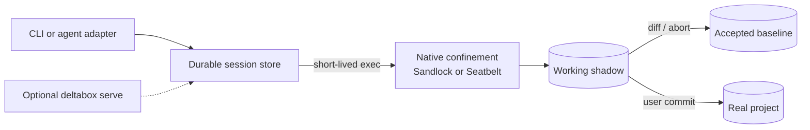

<div align="center">

# Deltabox-lite

**Lightweight, agent-native sandboxing with diff · commit · abort.**

Give agents a workspace they can break - without ever breaking your project.

[](#license)
[](#)
[](#)
[](docs/protocol.md)
[](https://github.com/Ddnirvana/pi-deltabox)

</div>

deltabox-lite is a standalone sandbox runtime for AI coding agents. Agents keep
full execution freedom inside a confined, copy-on-write workspace, and every
change they make can be **reviewed**, **committed**, or **aborted** — per task
or per tool call.

Think of it as Git for agent sessions: less ceremony, more control, and no
anxiety about binary or large files.

## Demo

The JSON-RPC protocol in action — sandboxed edits, diff, abort, redo, commit:


## Highlights

- **Native isolation, not a container** — Linux uses Landlock, seccomp and
  sandlock COW; macOS uses Seatbelt plus APFS-cloned shadows. Both enforce the
  same durable review and policy model without root.
- **Service-free durable sessions** — accepted and pending views live on disk,
  so separate CLI processes can continue a session without a daemon. Optional
  `serve` transport remains available for adapters that prefer JSON-RPC.
- **Diff / commit / abort** — unified text diffs, binary and large-file
  markers, and a checkpoint chain. Apply changes to the real project or
  discard them in milliseconds.
- **Review-scope savepoints** — task and tool adapters choose the correct abort
  target; normal commit and abort do not require a user-created checkpoint.
- **Agent-agnostic** — a line-delimited JSON-RPC protocol over stdio. The Pi
  adapter ships as [pi-deltabox](https://github.com/Ddnirvana/pi-deltabox);
  adapters for other agents speak the same protocol.
- **Policy-first** — filesystem read/write rules, secret-path denial, network
  allow/audit, deny-all and allowlist modes, scrubbed child environments, and
  bounded writes/storage.

## How it works



The on-disk session store owns accepted and working project views. Each normal
CLI `exec` launches a short-lived confined COW transaction and materializes its
result into the working shadow; the real project remains untouched until user
commit. `deltabox serve` is an optional persistent transport process that uses
the same per-command transactions; it is not the source of session truth. See
[session semantics](docs/session-semantics.md).

## Quick start

Build the runtime:

```bash
cargo build --release
export PATH="$PWD/target/release:$PATH"
```

Start a durable session and use it from independent CLI processes:

```bash
deltabox session start /abs/path/my-project
# prints a session id
deltabox exec <id> --project /abs/path/my-project -- npm install
deltabox diff <id> --project /abs/path/my-project
deltabox commit <id> --project /abs/path/my-project
```

No service needs to be started first. To use the optional JSON-RPC transport:

```bash
cd my-project
deltabox serve
```

The optional server speaks line-delimited JSON-RPC (see
[docs/protocol.md](docs/protocol.md)). A minimal session looks like:

```json
{"id":1,"method":"session.start","params":{"project":"/abs/path/my-project"}}
```

From there, `session.exec`, `fs.write`, `checkpoint.create`, `diff.list`,
`changes.commit`, `changes.abort`, and the `review.*` scope methods drive the
whole lifecycle.

The fastest way to see it with an agent is the Pi extension:

```bash
pi install npm:pi-deltabox
```

## Policy

`session start --policy policy.toml` accepts filesystem, network, and resource
limits. The default agent policy uses the `allow_audit` network mode, denies
common secret paths, passes only a small environment allowlist to commands,
caps one direct write at 16 MiB, and caps pending added/modified file content at
1 GiB. Network policy can instead deny all access or allow only explicit
host-and-port targets:

```toml
[network]
mode = "allowlist"
allow = ["registry.npmjs.org:443", "127.0.0.1:3000"]

[limits]
max_write_bytes = 16777216
max_storage_bytes = 1073741824
```

See [policy reference](docs/policy.md) for the full schema and enforcement
semantics, and [macOS compatibility](docs/macos.md) for path mapping and tool
support.

## Performance

Measured on x86-server (Linux 6.18, ext4, release build). Each row reports 25
no-op commands over the same durable session; CLI mode starts a fresh sandbox
process for every command.

| Transport | Files | p50 | p95 |
|---|---:|---:|---:|
| service-free CLI (default) | 10 | 51 ms | 80 ms |
| service-free CLI (default) | 200 | 41 ms | 78 ms |
| service-free CLI (default) | 1000 | 69 ms | 90 ms |
| optional `serve` | 10 | 59 ms | 73 ms |
| optional `serve` | 200 | 54 ms | 84 ms |
| optional `serve` | 1000 | 81 ms | 227 ms |

The 1000-file CLI run had one 211 ms outlier; the serve run had a 397 ms
outlier. Persisted scan indexes and changed-path materialization keep median CLI
latency from scaling with a full working-tree copy.

Measured on an Apple-silicon MacBook Air (macOS 14.6, APFS, release build).
Each row reports the p50 of 30 interleaved no-op commands after three warmups
over a pre-created project and session.

| Runner | 10 files | 200 files | 1000 files |
|---|---:|---:|---:|
| service-free CLI (default) | 88 ms | 142 ms | 333 ms |
| optional `serve` | 84 ms | 138 ms | 324 ms |
| Anthropic sandbox-runtime 0.0.70 | 137 ms | 137 ms | 137 ms |
| Carderne sandbox-runtime 0.0.69 | 132 ms | 133 ms | 129 ms |
| raw `sandbox-exec` | 10 ms | 10 ms | 10 ms |
| plain shell | 3 ms | 3 ms | 3 ms |

The raw Seatbelt row denies network but allows filesystem access, so it is a
launch-overhead baseline rather than a sandbox with Deltabox semantics.
Deltabox clones and validates a crash-recoverable candidate tree for every
arbitrary command. APFS makes file contents copy-on-write, but directory entry
creation and metadata validation still scale with the number of files.

## Project layout

- `crates/deltabox-core` — sessions, checkpoints, diff/commit/abort, policy,
  journal, platform backends.
- `crates/deltabox-cli` — the `deltabox` binary (CLI + stdio JSON-RPC server).
- `examples/rpc-demo.mjs` — a runnable JSON-RPC demo.
- `docs/protocol.md` — the stable JSON-RPC contract.
- `docs/policy.md` — policy schema and enforcement boundaries.
- `docs/macos.md` — macOS backend behavior and compatibility matrix.


## Citation

If you find deltabox-lite useful, please cite the original paper of DeltaBox (which is based on microVM) or this github repo:

```bibtex
@misc{dong2026deltaboxscalingstatefulai,
      title={DeltaBox: Scaling Stateful AI Agents with Millisecond-Level Sandbox Checkpoint/Rollback}, 
      author={Yunpeng Dong and Jingkai He and Shiqi Liu and Yuze Hou and Dong Du and Zhonghu Xu and Si Yu and Baochuan Yang and Yubin Xia and Haibo Chen},
      year={2026},
      eprint={2605.22781},
      archivePrefix={arXiv},
      primaryClass={cs.OS},
      url={https://arxiv.org/abs/2605.22781}, 
}
```


## License

Apache-2.0.

## Acknowledgments

This project utilizes excellent work of existing sandbox projects like **[`sandlock`](https://github.com/multikernel/sandlock)**.


**⭐ Star this repo if you find deltabox-lite helpful!**
