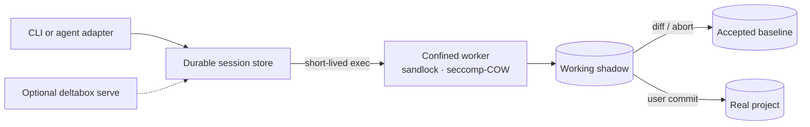

<div align="center">

# Deltabox-lite

**Lightweight, agent-native sandboxing with diff · commit · abort.**

Give agents a workspace they can break - without ever breaking your project.

[](#license)
[](#)
[](#)
[](docs/protocol.md)
[](https://github.com/Ddnirvana/pi-deltabox)

</div>

deltabox-lite is a standalone sandbox runtime for AI coding agents. Agents keep
full execution freedom inside a confined, copy-on-write workspace, and every
change they make can be **reviewed**, **committed**, or **aborted** — per task
or per tool call.

Think of it as Git for agent sessions: less ceremony, more control, and no
anxiety about binary or large files.

## Demo

The JSON-RPC protocol in action — sandboxed edits, diff, abort, redo, commit:


## Highlights

- **Real isolation, not a wrapper** — Linux commands run inside a local 
  sandbox with seccomp copy-on-write, Landlock filesystem policy (based on sandlock), resource
  limits, and an audited network allowlist.
- **Service-free durable sessions** — accepted and pending views live on disk,
  so separate CLI processes can continue a session without a daemon. Optional
  warm `serve` mode remains available for adapters and latency-sensitive use.
- **Diff / commit / abort** — unified text diffs, binary and large-file
  markers, and a checkpoint chain. Apply changes to the real project or
  discard them in milliseconds.
- **Review-scope savepoints** — task and tool adapters choose the correct abort
  target; normal commit and abort do not require a user-created checkpoint.
- **Agent-agnostic** — a line-delimited JSON-RPC protocol over stdio. The Pi
  adapter ships as [pi-deltabox](https://github.com/Ddnirvana/pi-deltabox);
  adapters for other agents speak the same protocol.
- **Policy-first** — filesystem read/write rules, secret-path denial, network
  allow + audit, and opt-in durability.

## How it works



The on-disk session store owns accepted and working project views. Each normal
CLI `exec` launches a short-lived confined COW transaction and materializes its
result into the working shadow; the real project remains untouched until user
commit. `deltabox serve` is an optional transport/warm-runner surface, not the
source of session truth. See [session semantics](docs/session-semantics.md).

## Quick start

Build the runtime:

```bash
cargo build --release
export PATH="$PWD/target/release:$PATH"
```

Start a durable session and use it from independent CLI processes (Linux
backend):

```bash
deltabox session start /abs/path/my-project
# prints a session id
deltabox exec <id> --project /abs/path/my-project -- npm install
deltabox diff <id> --project /abs/path/my-project
deltabox commit <id> --project /abs/path/my-project
```

No service needs to be started first. To use the optional JSON-RPC transport:

```bash
cd my-project
deltabox serve
```

The optional server speaks line-delimited JSON-RPC (see
[docs/protocol.md](docs/protocol.md)). A minimal session looks like:

```json
{"id":1,"method":"session.start","params":{"project":"/abs/path/my-project"}}
```

From there, `session.exec`, `fs.write`, `checkpoint.create`, `diff.list`,
`changes.commit`, and `changes.abort` drive the whole lifecycle.

The fastest way to see it with an agent is the Pi extension:

```bash
pi install npm:pi-deltabox
```

## Performance

Measured on x86-server (Linux 6.18, ext4, release build; 1000-file tree unless noted).

| Operation | p50 |
|---|---|
| `exec sh -c true` (warm session) | 8.6 ms |
| protocol ping | 87 µs |
| checkpoint (200-file tree, 20 changes) | 10.9 ms |
| checkpoint (no changes) | 5.4 ms |
| diff / scan (1000 files) | ~26 ms |
| commit (100 pending files) | ~58 ms |
| abort (100 pending files) | ~77 ms |

For comparison, a fresh `bwrap sh -c true` on the same host is 9.83 ms (p50):
deltabox-lite pays a similar isolation cost per command, then keeps the session
warm so checkpoints and diffs stay in the millisecond range.

## Project layout

- `crates/deltabox-core` — sessions, checkpoints, diff/commit/abort, policy,
  journal, platform backends.
- `crates/deltabox-cli` — the `deltabox` binary (CLI + stdio JSON-RPC server).
- `examples/rpc-demo.mjs` — a runnable JSON-RPC demo.
- `docs/protocol.md` — the stable JSON-RPC contract.


## Citation

If you find deltabox-lite useful, please cite the original paper of DeltaBox (which is based on microVM) or this github repo:

```bibtex
@misc{dong2026deltaboxscalingstatefulai,
      title={DeltaBox: Scaling Stateful AI Agents with Millisecond-Level Sandbox Checkpoint/Rollback}, 
      author={Yunpeng Dong and Jingkai He and Shiqi Liu and Yuze Hou and Dong Du and Zhonghu Xu and Si Yu and Baochuan Yang and Yubin Xia and Haibo Chen},
      year={2026},
      eprint={2605.22781},
      archivePrefix={arXiv},
      primaryClass={cs.OS},
      url={https://arxiv.org/abs/2605.22781}, 
}
```


## License

Apache-2.0.

## Acknowledgments

This project utilizes excellent work of existing sandbox projects like **[`sandlock`](https://github.com/multikernel/sandlock)**.


**⭐ Star this repo if you find deltabox-lite helpful!**
