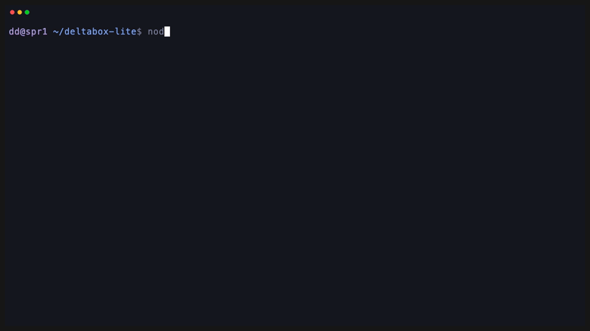
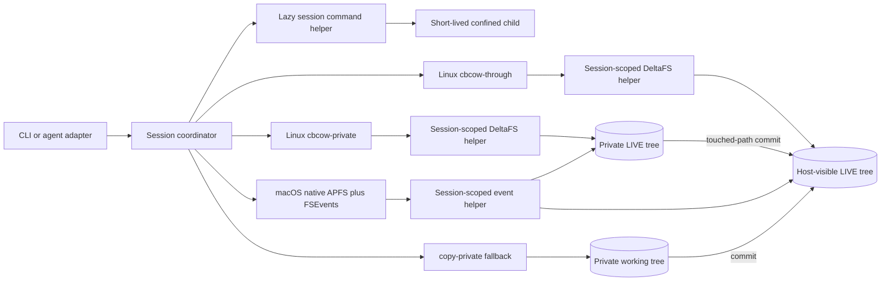

<div align="center">

# Deltabox-lite

**Lightweight, agent-native sandboxing with diff · commit · abort.**

Give agents a confined workspace with explicit diff, commit, and abort semantics.

[](#license)
[](#)
[](#)
[](https://github.com/Ddnirvana/pi-deltabox)

</div>

deltabox-lite is a standalone sandbox runtime for AI coding agents. Agents keep
full execution freedom inside a confined filesystem view, and every change
they make can be **reviewed**, **committed**, or **aborted** - per task or per
tool call. Linux defaults to a commit-biased FUSE view; macOS uses native APFS
clones and FSEvents. Private modes keep changes hidden from the host until
commit.

Think of it as Git for agent sessions: less ceremony, more control, and no
anxiety about binary or large files.

## Demo

Run a command, inspect its change set, and choose whether to keep or discard it:



## Highlights

- **Native isolation, not a container** - Linux composes Sandlock/Landlock/
  seccomp with DeltaFS FUSE; macOS uses Seatbelt plus APFS clones and FSEvents.
- **Service-free durable sessions** - Linux starts a session-scoped filesystem
  helper and macOS starts a session-scoped event helper automatically. Durable
  files remain authoritative across independent CLI processes; no global daemon
  or manual service startup is required.
- **Three filesystem modes** - `cbcow-through` makes changes visible
  immediately and makes commit an O(1) acceptance operation. `cbcow-private`
  runs the same DeltaFS engine over a private reflink/copy tree and publishes
  only touched paths at commit. `copy-private` remains the compatibility
  fallback.
- **Diff / commit / abort** - unified text diffs, binary and large-file
  markers, and a linear checkpoint chain. Abort restores the selected
  checkpoint; commit accepts the current state.
- **Review-scope savepoints** — task and tool adapters choose the correct abort
  target; normal commit and abort do not require a user-created checkpoint.
- **Agent adapters** — optional JSON-RPC over stdio for Pi and other
  integrations; see the [adapter protocol](docs/protocol.md).
- **Policy-first** — filesystem read/write rules, secret-path denial, network
  allow/audit, deny-all and allowlist modes, scrubbed child environments, and
  bounded writes/storage.

## Quick start

Build the runtime:

```bash
cargo build --release
export PATH="$PWD/target/release:$PATH"
```

Release builds are also packaged for npm on Linux and macOS, x64 and arm64:

```bash
npm install --global deltabox-lite
```

The npm package exposes the platform prebuild directly. Pi integrations resolve
the same native binary, so commands do not start an extra Node process.

For a first transaction, create a project with one ordinary file and discard a
command's changes. No package manifest or policy file is needed:

```bash
demo=$(mktemp -d)
cd "$demo"
printf 'original\n' > notes.txt

deltabox run --abort -- sh -c '
  printf "sandboxed\n" >> notes.txt
  printf "generated\n" > generated.txt
  find . -maxdepth 1 -type f -print
'

cat notes.txt
test ! -e generated.txt
```

The command runs inside the sandbox view, prints the diff, and then aborts. The
original `notes.txt` remains unchanged and `generated.txt` is removed.

To keep a result, use the same one-command interface with `--commit`:

```bash
deltabox run --commit -- sh -c 'printf "accepted by deltabox\n" > accepted.txt'
cat accepted.txt
```

`run` creates and cleans up a temporary transaction. Scripts and agent
integrations should select `--commit` or `--abort` explicitly; the child exit
status is preserved after that decision.

For multiple independent commands, start a persistent session. Commands run from
the project directory can omit `--project`; use it only when invoking Deltabox
from another directory:

```bash
cd /abs/path/my-project
session_id=$(deltabox session start .)
deltabox exec "$session_id" -- sh -c 'printf "step one\n" > step-one.txt'
deltabox exec "$session_id" -- sh -c 'printf "step two\n" > step-two.txt'
deltabox diff "$session_id"
deltabox commit "$session_id"
deltabox session stop "$session_id"
```

Session records live in `<project>/.deltabox` by default, so each project stays
self-contained. Set `DELTABOX_STATE_DIR=/path/to/state` to relocate session
records and engine state to an arbitrary path instead.

### Shell command syntax

`deltabox exec` and `deltabox run` execute the argv after `--` directly. Commands
that do not require shell parsing can be passed as ordinary arguments:

```bash
deltabox exec "$session_id" -- git status --short
deltabox exec "$session_id" -- curl -fL -o source.tar.gz https://example.com/source.tar.gz
```

Redirection, pipes, variable expansion, globbing, and command lists require an
explicit shell. Keep the complete script inside quotes so the outer host shell
cannot perform the filesystem operation before Deltabox starts:

```bash
deltabox exec "$session_id" -- sh -c 'printf "%s\n" hello > hello.txt'
deltabox run --abort -- sh -c 'printf "%s\n" trial > trial.txt'
deltabox exec "$session_id" -- sh -c 'find . -type f | sort > files.txt'
deltabox exec "$session_id" -- sh -c 'command-that-may-be-quiet >/dev/null 2>&1'
```

This form is wrong because the host shell handles `>` and creates `hello.txt`
outside the sandbox transaction:

```bash
deltabox exec "$session_id" -- echo hello > hello.txt
```

Quoting the whole command without `sh -c` is also wrong: Deltabox would treat
the complete string as an executable filename. Sandboxed commands do not receive
a terminal on stdin, so use non-interactive flags for tools such as Git.

### Choosing a filesystem mode

Linux and macOS request `cbcow-through` by default and visibly fall back to
`copy-private` if the native provider is unavailable. Select the mode
explicitly when a workflow requires it:

```bash
deltabox session start /abs/path/my-project --fs-mode copy-private
deltabox session start /abs/path/my-project --fs-mode cbcow-private --require-fs-mode
deltabox session start /abs/path/my-project --fs-mode cbcow-through --require-fs-mode
deltabox session start /abs/path/my-project --fs-mode cbcow-through --durable
deltabox session start /abs/path/my-project --fs-mode cbcow-through --durable --group-commit-ms 2
```

Fast mode is the default and recovers helper/process failures. `--durable`
adds ordered storage barriers; success from commit means changed files,
affected directories, and the acceptance marker are synchronized.
`--group-commit-ms` lets concurrent mutations share an `APPLIED` journal
barrier while preserving that per-operation success boundary.
Strict mode requires `cbcow-through` or `cbcow-private`; startup fails instead
of falling back to `copy-private` when the requested provider is unavailable.
On macOS, fast `cbcow-through` also assumes Deltabox is the exclusive project
writer. Fast `exec` defers FSEvents accounting to the next state operation;
strict mode closes a sentinel boundary before each result, detects external
writes, and refuses an unsafe abort. Use `cbcow-private` when host isolation is
required before commit.

The fastest way to see it with an agent is the Pi extension:

```bash
pi install npm:pi-deltabox
```

## How it works



On Linux with FUSE available, `session start` launches a helper that mounts the
host project through the commit-biased state engine. Writes update the host
tree through DeltaFS after recording rollback data; commit accepts the current
state and abort replays undo records. `cbcow-private` preserves the same fast
per-command path while keeping its `LIVE` tree hidden from the host until a
conflict-checked commit. In `copy-private`, each command updates a durable
private working tree and commit publishes it to the project.
On macOS, the same modes use APFS-cloned state and a restartable FSEvents helper
instead of a mount. The helper only keeps the event stream warm; persisted
cursors and indexes remain authoritative.
The first CB-CoW `exec` also launches a restartable command helper. Later CLI
operations reuse its warm Sandlock worker on Linux or Seatbelt profile/proxy on
macOS without making that helper authoritative session state. Durable files,
not a long-running process, remain the source of session truth. See [session
semantics](docs/session-semantics.md).

## Policy

`session start --policy policy.toml` accepts filesystem, network, and resource
limits. The default agent policy uses the `allow_audit` network mode, denies
common secret paths, passes only a small environment allowlist to commands,
caps one direct write at 16 MiB, and caps pending added/modified file content at
1 GiB. Network policy can instead deny all access or allow only explicit
host-and-port targets:

```toml
[network]
mode = "allowlist"
allow = ["registry.npmjs.org:443", "127.0.0.1:3000"]

[limits]
max_write_bytes = 16777216
max_storage_bytes = 1073741824
```

See [policy reference](docs/policy.md) for the full schema and enforcement
semantics, and [macOS compatibility](docs/macos.md) for path mapping and tool
support.

## Performance

Measured on x86-server (Linux 6.18, ext4, release build). Each row reports 50
no-op commands after five warmups. Deltabox uses independent CLI processes over
one `cbcow-through` session.

| Runner | 10 files p50 / p95 | 200 files p50 / p95 | 1000 files p50 / p95 |
|---|---:|---:|---:|
| `cbcow-through` | 13.7 / 15.5 ms | 14.3 / 15.4 ms | 13.2 / 14.7 ms |
| raw Sandlock | 8.1 / 9.4 ms | 8.2 / 9.0 ms | 8.1 / 8.9 ms |
| plain shell | 1.3 / 1.7 ms | 1.2 / 1.6 ms | 1.2 / 1.5 ms |

The no-op path does not scan or copy the project per command. Empty DeltaFS
checkpoint and commit operations remain below 1 ms in the scaling benchmark.

The delta-driven path can outperform repeated Sandlock copy-up work when a workload makes many small changes.

| Microbenchmark | `cbcow-through` p50 / p95 | raw Sandlock p50 / p95 | Faster path |
|---|---:|---:|---|
| One 4 KiB write in a 256 MiB existing file | 46.4 / 47.3 ms | 166.0 / 187.7 ms | `cbcow-through` |
| 16 commands, one 4 KiB write per 32 MiB file, one final commit | 509.0 / 509.6 ms | 4809.5 / 5761.2 ms | `cbcow-through` |

Raw Sandlock has no durable cross-command session, so the second row commits each one-shot command independently.

On macOS, the native provider materializes its APFS accepted base once at
session start. Fast commands do not clone or scan the project per invocation;
status, diff, checkpoint, commit, and abort close the FSEvents reconciliation
boundary. Private mode additionally materializes a private APFS `LIVE` tree and
therefore trades more startup and command-path work for pre-commit host
isolation.

## Project layout

- `crates/deltabox-core` — sessions, checkpoints, diff/commit/abort, policy,
  journal, platform backends.
- `crates/deltabox-cli` — the `deltabox` command-line binary.
- `deltafs-fuse` — the standalone commit-biased state engine, FUSE adapter,
  helper, and local control protocol.
- `docs/policy.md` — policy schema and enforcement boundaries.
- `docs/macos.md` — macOS backend behavior and compatibility matrix.


## Citation

If you find deltabox-lite useful, please cite the original paper of DeltaBox (which is based on microVM) or this github repo:

```bibtex
@misc{dong2026deltaboxscalingstatefulai,
      title={DeltaBox: Scaling Stateful AI Agents with Millisecond-Level Sandbox Checkpoint/Rollback}, 
      author={Yunpeng Dong and Jingkai He and Shiqi Liu and Yuze Hou and Dong Du and Zhonghu Xu and Si Yu and Baochuan Yang and Yubin Xia and Haibo Chen},
      year={2026},
      eprint={2605.22781},
      archivePrefix={arXiv},
      primaryClass={cs.OS},
      url={https://arxiv.org/abs/2605.22781}, 
}
```


## License

Apache-2.0.

## Acknowledgments

This project utilizes excellent work of existing sandbox projects like **[`sandlock`](https://github.com/multikernel/sandlock)**.


**⭐ Star this repo if you find deltabox-lite helpful!**
