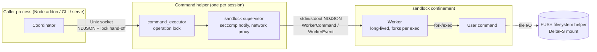
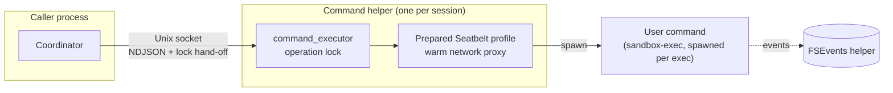
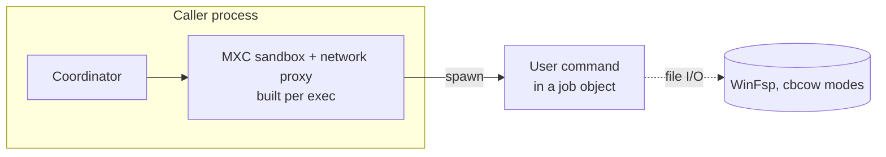
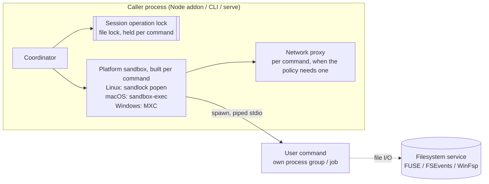
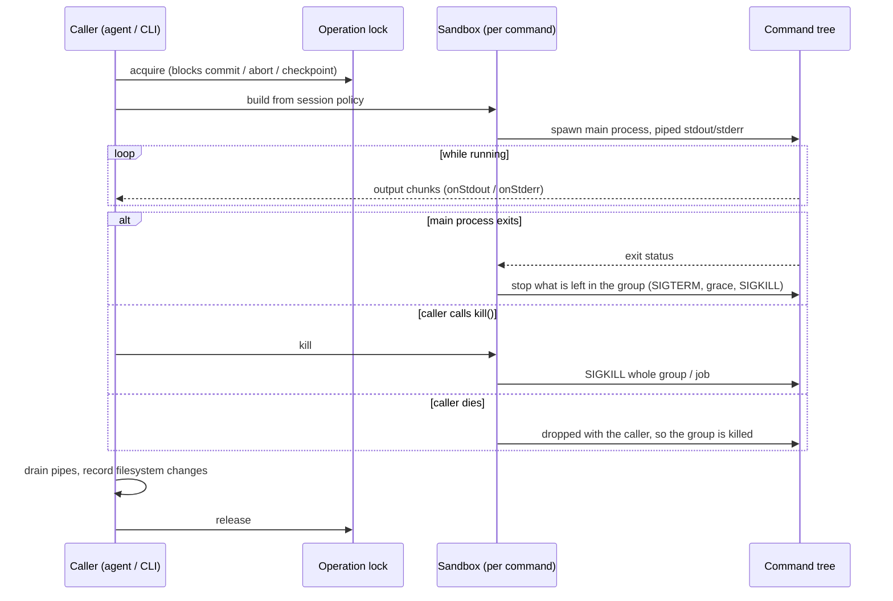

# Process model: the caller owns the sandbox

Status: **proposal**. This document describes how commands run today on each
platform, and a single model to converge on. It changes no code by itself; the
migration steps at the end are separate changes.

## Summary

Every platform should run a command the same way:

1. The process that asks for the command (the Node host, `deltabox exec`, or
   `deltabox serve`) builds a sandbox **for that one command**.
2. The command runs as a confined child of that caller. Its output streams
   straight back over pipes.
3. When the command's main process exits, everything still in its process
   tree is stopped. When the caller dies, the command dies with it.
4. A file lock held by the caller for the command's lifetime keeps commit,
   abort and checkpoint from running while the command writes.

Windows already works this way. Linux and macOS route commands through a
session-scoped command helper, and on Linux also through a long-lived
in-sandbox worker. Both exist mainly to keep the sandbox warm, and to keep a
command alive and serialized after the CLI process that started it exits.
Under this model neither is needed.

Filesystem services stay as they are: the Linux FUSE helper, the macOS FSEvents
helper and WinFsp hold durable filesystem state, not commands.

## Today

### Linux (`cbcow-*`, sandboxed)

Two IPC protocols sit between the caller and the command, and each must carry
requests, results, cancellation and, with streaming, output chunks.

### macOS (`cbcow-*`, sandboxed)

The command is already spawned fresh for every exec. The helper keeps the
profile and network proxy warm, and holds the lock across CLI processes.

### Windows (MXC)

No helper and no IPC. The caller builds the sandbox for each command, and
tearing down the job object ends the command's whole tree.

### Copy-private and trusted mode

`copy-private` runs its sandbox from the caller (`durable.rs`) on every
platform, but on Linux it still goes through the worker. Trusted mode
(`isolation: none`) runs commands in the caller's own process group.

## Proposed

One path on every platform. The only processes besides the caller and the
command are the filesystem services, which already exist for durability.

### Command lifecycle

### What each piece guarantees

| Concern | Today (Linux / macOS) | Proposed (all platforms) |
| --- | --- | --- |
| Confinement | Applied once to the worker (Linux) or per spawn (macOS) | Applied per command |
| Commit vs. running command | Operation lock handed to the helper over the socket | File lock held by the caller; the OS releases it if the caller dies |
| Caller killed mid-command | Command keeps running in the helper, which keeps the lock | Command is killed with its sandbox; no orphaned command exists |
| Leftover background processes | Stopped when the main process exits | Same |
| Output streaming | Chunks relayed over one or two protocols | Pipes read directly by the caller |
| Network proxy | Warm per session in the helper | Per command (as on Windows) |
| Cost per command | Fork from a warm worker | About 2 ms more on Linux; to be measured with real policies |

The Linux cost was measured by building a fresh sandlock sandbox for each
`/bin/true` (about 3.2 ms against 1.0 ms for a plain spawn, 50 runs). That
benchmark had no project deny paths, limits or proxy, so the real number must
be measured before migrating.

## Trade-offs

- **Crash isolation.** sandlock's seccomp-notify supervisor runs in the
  caller. For the Node host, a supervisor hang or panic now affects the host
  process, not a separate helper. The addon already runs a multi-threaded
  async runtime, which the supervisor needs. Pipes must be read off the
  runtime's executor so they cannot starve it.
- **The command needs a live caller.** A command lives only as long as the
  process that started it. This is the intended `bwrap --die-with-parent`
  behaviour, but a CLI user who kills `deltabox exec` also kills the command.
- **Per-command setup.** Every command pays for building its sandbox and, where
  the policy needs one, its network proxy.
- **PTY.** sandlock 0.8's `popen` offers `Inherit`, `Piped` or `Null` for each
  stream. A future PTY mode (#42 stage 2) needs sandlock support, or the caller
  passing a PTY as the inherited stdio.

## Migration

1. **Linux:** replace the command helper and worker with per-command
   `Sandbox::popen` in the caller. Hold the operation lock as a file lock.
   Delete `worker.rs`, the worker protocol and the helper's exec path.
2. **macOS:** spawn `sandbox-exec` from the caller, with a per-command network
   proxy. Retire the command helper.
3. **Shared exec path:** one `spawn → stream → settle` routine used by all
   backends. Streaming `spawn()` handles (#66, #68) build on it directly,
   without socket output frames.
4. Measure `deltabox exec` latency before and after each step with
   representative policies, on Linux and macOS.

## Open questions

- Does any caller rely on a command surviving the death of the process that
  started it? `deltabox serve` and the Node host both live as long as their
  sessions, so this mainly affects killed CLI invocations.
- Should the per-command network proxy be shared within one caller process
  across that session's concurrent commands?
- Does the operation lock need to be shared (readers) for read-only operations
  such as `diff` while a command runs, or stay exclusive?
